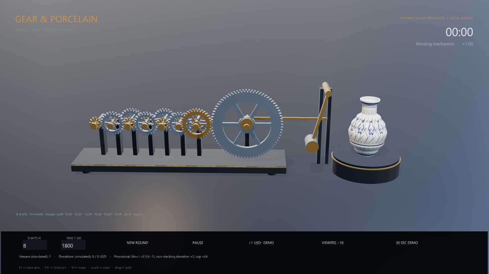

# YTGears / Gear & Porcelain — Python 3D

Язык интерфейса приложения — английский.

Интерактивная трёхмерная сцена на **Python + Panda3D**: металлическая составная передача, фарфоровая ваза с синим орнаментом, взвод и удар молоточка, физические осколки, звук, музыка и итоговый экран. C# и .NET больше не нужны.

**Это работающий 3D-прототип.** Модели и орнамент создаются процедурно; разрушение сейчас рассчитывает Bullet в реальном времени. Художественная сцена с рассчитанным в Blender разрушением, реальные YouTube/платёжные подключения и качество для итогового эфира ещё предстоят.



## Запустить приложение

Windows: дважды щёлкните **`start.bat`**. Он создаст локальное окружение Python, установит зависимости и откроет 3D-окно. Нужен установленный Python 3.11+ и OpenGL 3.3; первый запуск требует интернет для установки пакетов.

Или из PowerShell:

```powershell
cd C:\Work\YTGears
.\start.bat
```

Короткий демонстрационный раунд примерно на 31 секунду:

```powershell
.\start.bat --demo
```

После установки окружения приложение запускается напрямую:

```powershell
.\.venv\Scripts\python.exe run.py
```

На Linux/macOS: `python3 -m venv .venv`, затем `.venv/bin/python -m pip install -r requirements.txt` и `.venv/bin/python run.py`. Эти платформы локально не запускались.

## Управление

- Поля **N** и **T** и кнопка «NEW ROUND»: создать механизм с выбранными параметрами. По умолчанию N=8 расчётных валов, T=1800 секунд, один имитируемый зритель.
- «+1 USD · DEMO» и «VIEWERS +10»: автономные входы без реальных денег/подключений.
- «30 SEC DEMO»: N=5, T=180 с, 51 имитируемый зритель; с учётом сглаживания удар примерно через 30.83 с.
- ЛКМ на сцене — поворот камеры; колесо — приближение.
- `Пробел` — пауза; `M` — музыка; `F2` — скрыть интерфейс для OBS; `F11` — полный экран; `F12` — снимок в `output`; `Esc` — выход.

На раунд приходится один удар; итоговый экран появляется через шесть секунд показа разрушения. Автоматического перезапуска нет.

## Геометрия и предварительные правила

Для компактной физической передачи N сейчас означает **число расчётных валов**; физических колёс — 2(N−1). Для N=8 это 14 колёс, что видно в интерфейсе. Ступени могут замедлять неравномерно, зато их целочисленные зубья точно дают выбранное T. При несовместимых N/T приложение выдаёт ошибку. Смысл N относительно исходного требования о числе видимых шестерёнок остаётся открытым вопросом; см. [решения](docs/Decisions.md).

Предварительно: `Mview=1+0.1×max(0,V−1)`, сглаживание 2 с, один ненакопительный донатный множитель ×2 до конца раунда, общий предел ×64. Экспоненциальное накопление не включено по умолчанию. Уникальная аудитория недоступна и не заменяется суммой онлайна.

## Структура

`ytgears/core.py` — независимое ядро; `scene.py` — 3D-приложение; `geometry.py` — модели; `audio.py` — оригинальный синтез звука; `scenario.py` — автономные JSON-входы. `examples` сохраняет прежний формат сценариев.

Для автономного JSON-проигрывания без графики: `python run.py --simulate examples/interactive.json`; для машинного отчёта добавьте `--json`. Денежные поля отчёта сериализуются строками без потери Decimal-точности.

[Архитектура](docs/Architecture.md) · [Запуск и настройки](docs/Runbook.md) · [Этапы](docs/ImplementationPlan.md) · [Отчёт](docs/DevelopmentReport.md). Исходные требования v1.2 сохранены без изменения.
