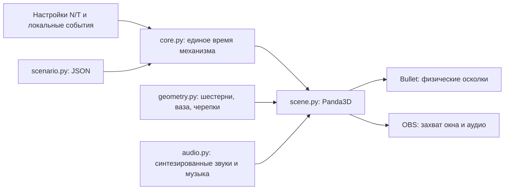

# Архитектура Python 3D

18 октября 2026. Пользователь выбрал Python и поручил сразу создать 3D-сцену. Предыдущая рекомендация Unity/C# отменена этим выбором. Требования v1.2 сохранены; существенных расхождений между Markdown и четырьмя страницами PDF ранее не обнаружено. AGENTS.md в проекте не найден.

## Реализованный стек

**Python 3.11+**, **Panda3D 1.10.16**, **panda3d-simplepbr 0.13.1**, Bullet из поставки Panda3D. На рабочем ПК используется Python 3.14. Пакеты закреплены в `requirements.txt`. C#-исходники, проекты, .NET-конфигурация и прежний runner удалены из рабочей версии; доступны в истории Git.

Panda3D предоставляет Python-управление сценой, геометрию, GUI, звук и Bullet. SimplePBR предоставляет metal/roughness-материалы, HDR-тональную компрессию, окружение и тени; см. [описание проекта](https://github.com/Moguri/panda3d-simplepbr). Материалы, свет и процедурные формы остаются основой прототипа; наличие PBR само по себе не означает реалистичное художественное качество.

## Компоненты

`core.py` не импортирует Panda3D. Параметры/политики и итоговый снимок — замороженные dataclass. Все вызовы последовательные. Хост передаёт реальные секунды из `time.perf_counter()`; M применяется только внутри ядра, не к глобальным часам движка. При ручной паузе активное время раунда останавливается. N/T и политика задаются при создании следующего раунда.

Механизм использует τ: интеграл произведения зрительского и донатного множителей с ограничением. Линейное сглаживание интегрируется по сегментам, в том числе при пересечении предела; шаг делится по срокам действия входов. Контакт внутри последнего сегмента определяется монотонным решением интеграла. Прогресс ограничивается 1; сигнал контакта выдаётся один раз. Состояния: Running → Impacted → Destruction → Results. Автоматического нового раунда нет.

Денежные значения — Decimal, JSON-вход читается с `parse_float=Decimal`. Двоичный float как сумма платежа отклоняется. Для точных сумм используется локальная точность 80 знаков, технический диапазон сохранён до 79228162514264337593543950335 и 28 дробных знаков. JSON-отчёт выводит денежные значения строками. Подтверждение, валюта, round ID и ключ `(provider,event_id)` проверяются до принятия. Защита от повторов действует в памяти одного объекта, не между перезапусками.

## Передача и целочисленные зубья

Математический `Transmission` по умолчанию сохраняет равномерное q=(T/12)^(1/(N−1)) для автономной симуляции. Для 3D `physical_transmission` ищет другой вариант: N−2 одинаковых рациональных ступеней и одну корректирующую, чтобы произведение отношений **точно** равнялось T/12. В каждой паре от 12 до 120 зубьев; отношения строго больше 1. Если решение не найдено, текущий раунд остаётся на экране, а настройки отклоняются с объяснением. Не все математически допустимые N/T поддерживаются 3D-компоновкой.

Для стандартных N=8, T=1800 найдены шесть пар 12:24 и последняя 32:75. Периоды: 12, 24, 48, 96, 192, 384, 768, 1800 с. Равномерное q здесь заменено **явно объявленной неравномерной передачей**. На восьми валах 14 физических колёс. Это разрешает конфликт точного общего отношения с целыми зубьями, но оставляет спорный смысл N: см. Decisions.md.

Зубья построены по эвольвентному профилю с углом давления 20°. Корневой переход упрощён; полной инженерной верификации подрезания, зазоров и контактного отношения нет. Входное и выходное колёса промежуточного вала находятся в разных плоскостях; валы/периоды и начальные фазы согласованы. Визуальная тяга/кулачок показывает связь с молоточком, но полный шарнирный механизм кинематически не решён.

## Сцена и удар

Процедурно создаются металлические зубчатые ободы со спицами, оси, опоры, основание, кулачок и молоточек. Ваза — тело вращения с наружной и внутренней поверхностью, толщиной 0.045 условной единицы, синим цветочным орнаментом и глазурованным материалом. Освещение: основная тень, холодный контровой источник, локальные источники и карта окружения. Камеру можно вращать/приближать.

Молоточек взводится от фазы последней ступени; последние 1.5% — ускоренный ход к контакту. В момент τ=T целая ваза скрывается, создаются 160 непрозрачных объёмных фрагментов с наружным орнаментом и светлым сколом. Bullet получает гравитацию, выпуклые коллайдеры, трение, упругость и CCD; основание и пол имеют статические коллайдеры. Разрушение идёт по собственному обычному времени, а не по M. Через 6 с появляется результат из замороженного снимка. Остаточные динамические движения после появления итогов останавливаются.

Контакт — авторская синхронизация геометрии в прототипе, не датчик физического столкновения. Точность физического касания, быстрые ускорения и полная модель защёлки требуют доработки. Взвод/предконтактная часть сейчас зависят от фазы механизма; художественная финальная анимация ещё не подготовлена.

**Разрушение пока не запечено в Blender.** Текущая сетка фрагментов регулярная, динамика рассчитывается в runtime. Требование/предложение Blender-воспроизведения не выдаётся за выполненное. Следующий художественный этап — нерегулярные фрагменты, сохранённые трансформации и одна контактная метка клипа.

Звук механизма, удар/звон черепков и фоновый музыкальный слой синтезированы локально на Python; внешних музыкальных материалов нет. WAV-кэш создаётся в `.cache/audio`. Во время удара музыка приглушается, `M` отключает её. Это простая звуковая основа для дальнейшего саунд-дизайна.

## Интерфейс и источники

По умолчанию открывается обычное 3D-окно 1600×900, а не консольный отчёт. Снизу настройки N/T, новый раунд, пауза, демонстрационные платежи/зрители и быстрый демонстрационный раунд. F2 скрывает интерфейс для OBS; F11 включает полный экран; F12 сохраняет кадр. Статус прототипа и локальных событий виден в окне.

YouTube и платёжные сервисы не подключены. Сцена обновляет известный **имитируемый** онлайн, чтобы TTL не истекал. Кнопки донатов не принимают деньги. Уникальные посмотревшие и ускорившие недоступны; пик имитируемого онлайна показан отдельно. Правила скорости обозначены предварительными и вынесены в `SpeedPolicy`.

Дальнейшие адаптеры должны проверять подписи, доступность метрик, квоты и свежесть, писать устойчивый inbox с уникальными ID и восстанавливать раунд после сбоя. Поле YouTube [concurrentViewers](https://developers.google.com/youtube/data/reference/rest/v3/videos#liveStreamingDetails.concurrentViewers) не является уникальной аудиторией раунда. OBS используется только для захвата.
