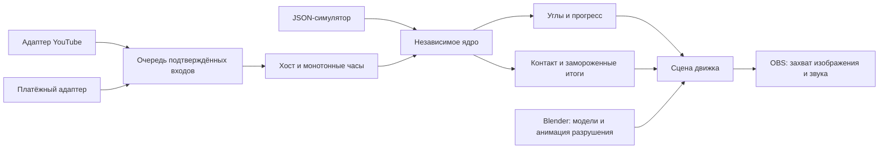

# Архитектура YTGears

Дата: 18 октября 2026. Статус: реализовано независимое ядро; выбор движка — рекомендация для следующего этапа.

## Исходное состояние и источники

Изучен `main` на коммите `e3133de`. В репозитории были только `docs/Requirements.md` и `docs/Gear_and_Porcelain_Requirements.pdf`, оба v1.2 от 18 октября 2026. `AGENTS.md`, код, проекты движка, модели, аудио, тесты и сборочные инструкции отсутствовали. Все четыре страницы PDF прочитаны и визуально проверены. Существенных расхождений между Markdown, PDF и текущим заданием не найдено. Открытые решения перечислены в [Decisions.md](Decisions.md); исходные требования не переписаны под реализацию.

## Инструменты

Рекомендуемый первый кандидат: **Unity 6 с HDRP, Blender и OBS**. Это рекомендация, а не утверждённый пользователем выбор движка. Точную версию Editor и пакетов следует закрепить после проверки целевого ПК. На этом этапе Editor не устанавливается, Unity-проект не создаётся.

| Компонент | Выбор и обоснование |
| --- | --- |
| Домен | C# 9, библиотека .NET Standard 2.1: без Unity API, сети и графики; удобна для подключения C#-адаптера, изолированно проверяется |
| CLI и проверки | .NET 10: уже доступен на рабочем ПК; JSON из стандартной библиотеки, без внешних NuGet-зависимостей |
| Реалистичная сцена | Кандидат Unity HDRP: физически основанные материалы и освещение, работа с металлическими поверхностями и глазурью; общий язык с ядром |
| Альтернатива | Unreal Engine: Lumen подходит для динамического света и отражений; потребует переноса ядра на C++ либо отдельного процесса с протоколом обмена |
| Модели и разрушение | Blender: моделирование, UV, текстуры, заранее рассчитанная динамика черепков; после расчёта экспорт трансформаций в ключи анимации |
| Эфир | OBS: захват окна приложения и аудио; не источник зрительской статистики |

HDRP ориентирован на производительные платформы и требует совместимого GPU — это подтверждает [документация Unity](https://docs.unity.com/en-us/engine/7000.0/manual/render-pipelines/high-definition-render-pipeline). Поэтому обещать разрешение и FPS до измерений нельзя. Возможности альтернативы описаны в [документации Epic о Lumen](https://dev.epicgames.com/documentation/en-us/unreal-engine/lumen-global-illumination-and-reflections-in-unreal-engine). Обоснование выбора Unity здесь — инженерная оценка сочетания графики и C#-интеграции, а не результат сравнения производительности на целевом ПК.

## Границы компонентов

Сейчас существуют ядро, симулятор и проверки. Остальные блоки — планируемые интеграции.

Ядро владеет параметрами текущего раунда, τ, состоянием ускорений, журналом уникальных платежей в памяти и неизменяемыми итогами. Хост владеет реальным монотонным временем, порядком входов, сохранением на диск, секретами и восстановлением после сбоя. Сцена читает углы и один сигнал контакта; она не вычисляет собственные независимые скорости шестерён.

Все вызовы ядра последовательные, на одном потоке. Сетевые адаптеры складывают входы в очередь. Перед применением входа хост продвигает ядро до времени его получения. Поздние сетевые события не перематывают прошлое. Дубликаты подтверждений используют одну пару `(provider, eventId)`; `roundId` защищает границу раунда.

## Расчёт времени и финала

`RoundParameters` неизменяем: N ≥ 2, T > 12 секунд. Технические пределы текущей реализации: N ≤ 4096, T ≤ 10^12 секунд. Это защитные ограничения памяти/чисел, не художественные требования.

`Transmission` вычисляет I=T/12, q=I^(1/(N−1)), Tk=12×I^((k−1)/(N−1)). Первый и последний периоды закрепляются точно как 12 и T. Направления внешних зацеплений чередуются; начальные фазы задаёт будущий адаптер геометрии.

`MechanismRound.Advance(dt)` интегрирует Mview×Mdonate с явным ограничением скорости. Шаг разделяется на границах срока жизни входов, окончания сглаживания и донатных эффектов. Линейное сглаживание интегрируется аналитически, включая пересечение ограничения. Внутри последнего сегмента контакт определяется решением монотонного интеграла. Это устраняет зависимость времени удара от крупного шага рендера. Остаток шага после контакта отбрасывается ядром.

Цикл: `Running → Impacted → Destruction → Results`. Только один вызов `Advance` возвращает `true`; к этому моменту итоги уже созданы. `BeginDestruction` и `CompleteDestruction` принимают только допустимый переход, повтор возвращает `false`. Нового раунда автоматически нет. Новые N и T передаются при создании нового объекта после решения оператора.

**Контакт пока логический.** В будущей сцене необходимо совместить τ=T с фактическим касанием молоточка. Если свободный полёт начинается только после τ=T, фактический контакт будет позже, что противоречит принятому определению времени. Поэтому последняя фаза движения молоточка должна завершать контакт на границе T; конкретный кулачок, защёлку и ход необходимо проверить на сцене. Нельзя скрыто прибавить время полёта к готовому результату. При высоком ускорении короткая фаза удара требует отдельной проверки читаемости.

Разрушение, звук контакта и черепков запускаются одним событием на обычных часах презентации. Скорость этой анимации не умножается на M. Хост учитывает уже прошедшую после контакта часть кадра. Заставка появляется только после завершения клипа, а берёт уже замороженные итоги. Симулятор лишь имитирует подтверждение завершения клипа.

## Геометрия: N расчётных ступеней не гарантирует N видимых колёс

У простой цепочки внешних зацеплений отношения телескопируются: общий коэффициент равен отношению зубьев последнего и первого колёс. Для I=150 и 12 зубьев у первого у последнего потребовалось бы 1800 зубьев. Промежуточные колёса не решают проблему размеров. Для компактного механизма нужны составные промежуточные валы с отдельными входными и выходными колёсами.

При трактовке N как числа расчётных валов в цепочке из N−1 пар требуется 2(N−1) физических колёс: для N=8 это 8 валов и 14 колёс. Это **кандидат компоновки**, который требует отдельного решения о количестве видимых шестерёнок. Ядро не выдаёт эти 14 колёс за утверждённые 8.

`ApproximateTeeth(12,120)` подбирает рациональное приближение равномерного q и сообщает достигнутый период и ошибку. Для N=8, T=1800 кандидат 22:45 даёт ошибку около −0,12942% (удар примерно на 2,33 с раньше). Он не подменяет точную виртуальную передачу ядра и всегда отмечен `GeometryApproved=false`.

Перед сценой нужно выбрать один вариант: разрешить неравномерные рациональные ступени с точным общим I; согласовать допуск к T; изменить число колёс/валов; ограничить доступные сочетания N/T готовыми физически корректными передачами. Для произвольного вещественного T точная реализация целыми зубьями в общем случае невозможна. Нужно также проверить модуль, профиль зуба, подрезание, межосевые расстояния, зазоры, пересечения и фазу зацепления. Подбор зубьев этого не проверяет.

## Зрители и донаты

Все текущие политики и значения по умолчанию описаны в [Runbook.md](Runbook.md), статус — в [Decisions.md](Decisions.md). На экране оператора и зрительском интерфейсе будущего приложения должны быть видны действующие правила и предел скорости.

Будущий YouTube-адаптер получает одновременный онлайн отдельно от OBS. У поля `liveStreamingDetails.concurrentViewers` есть условия доступности; [официальная документация YouTube](https://developers.google.com/youtube/data/reference/rest/v3/videos#liveStreamingDetails.concurrentViewers) не определяет его как уникальных зрителей раунда. Пропавшее поле преобразуется в `null`, а не в ноль. Адаптер должен следить за квотами, ошибками и свежестью. Чат-участники также не равны всем зрителям.

В ядре уникальные посмотревшие и ускорившие всегда `null`, пока нет достоверного источника. Пик — только максимум полученных отсчётов, а не полный истинный максимум между опросами. Пропуски данных отмечаются отдельно. Новую достоверную метрику следует добавлять с источником, областью раунда и временем измерения; запоздалую аналитику нельзя выдавать за известную при ударе.

Платёжный адаптер в дальнейшем проверяет подпись, подтверждение, валюту и принадлежность раунду до передачи события. Входной флаг `Confirmed` в симуляторе не является проверкой реального платежа. Используется `decimal`, не двоичная арифметика денег. Валютный обмен и комиссии не рассчитываются; принимается только USD. Дубликат с изменённой суммой выдаёт конфликт и не меняет результат. Неподтверждённое событие не занимает ID и может позже подтвердиться.

Для реальных платежей нужны устойчивый inbox/журнал с уникальным ключом, транзакционная дедупликация, сохранение конфигурации/входов и восстановление состояния. Текущая память ядра защищает только живой объект раунда; перезапуск процесса не даёт гарантии exactly-once. Поздние платежи получают `RoundClosed`; автоматического переноса нет, адаптер обязан отдельно сохранить их для сверки.

## Производство визуальной сцены

1. Blender: эталон масштаба, модель шестерён и составных валов, металлические PBR-карты, ваза с толщиной стенки, глазурью и орнаментом.
2. Заранее расколоть вазу, подготовить непрозрачные поверхности скола, крупные и мелкие фрагменты. Рассчитать динамику с основанием, сохранить кэш, затем запечь трансформации. Механизм кэширования описан в [руководстве Blender](https://docs.blender.org/manual/id/dev/physics/baking.html). Экспорт в движок необходимо проверить отдельным пробным ассетом; внутренний кэш Blender сам по себе не является runtime-форматом.
3. В Unity-кандидате: HDRP-материалы и отражения, постановочный свет, камера, взвод и контакт, фиксированное воспроизведение трансформаций черепков. Для первого разрушения предпочтительны ключи transform; Alembic — отдельная оценка размера и поддержки.
4. Раздельные каналы звука: механизм, защёлка/удар, черепки, музыка; приглушение музыки при ударе. Лицензии музыки проверяются до эфира.
5. Профилирование приложения вместе с кодированием OBS на целевом ПК. OBS рекомендует [Game Capture для игр на Windows](https://obsproject.com/kb/game-capture-source); провести реальную пробу захвата и аудиосинхронизации.

Ни один из этих визуальных пунктов ещё не выполнен. Успех консольных проверок не подтверждает реалистичность сцены, отсутствие прохода черепков сквозь основание или синхронность аудио.
